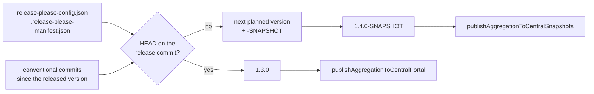
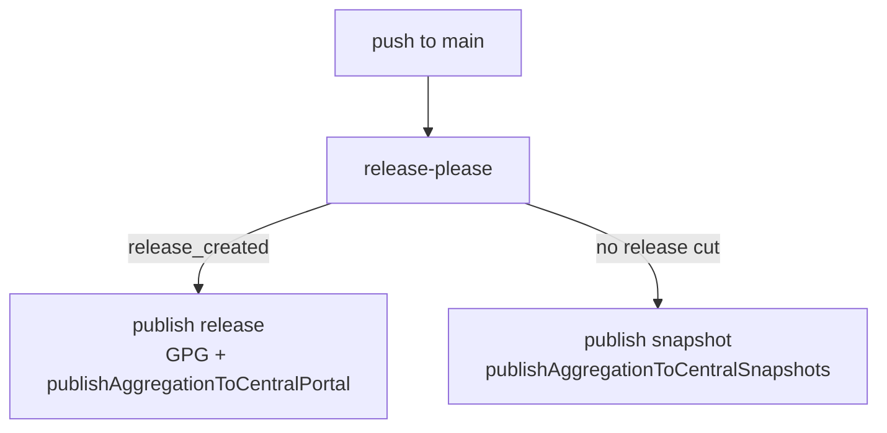

## Context

The build has two version authorities in play. `release-please` (`release.yml`) consumes conventional
commits, maintains the CHANGELOG and creates `v<major>.<minor>.<patch>` tags. The convention plugin
independently shells out to `git describe` and derives a Gradle version from it. Today the second
authority produces `<hash>-SNAPSHOT` off-tag, because the repository has no tags at all
(`git tag -l` is empty and `git describe --tags --always` falls back to the abbreviated hash).

That version string is unusable as a snapshot coordinate: it changes on every commit, so nothing can
depend on it as a moving target, and the Central Portal snapshot endpoint requires a version ending
in `-SNAPSHOT`. The practical consequence is that nothing can be published until release-please cuts
a first release.

Separately, `./gradlew antora` is invoked from `build.yml` and `release.yml` but no such task exists —
there is no `docs` module, no Antora plugin in `buildSrc`, and no Antora configuration in the
repository. Both workflows fail at that step.

Constraints that shape the design:

- `org.gradle.configuration-cache=true` and `org.gradle.configureondemand=true` are on, so whatever
  computes the version must be cache-correct: invalidated by a new commit or tag, not by nothing.
- `maven-publish` and nmcp read `project.version` during the configuration phase, so the version must
  resolve then, not at execution time.
- Isolated projects is already blocked upstream by the pitest plugin (documented in
  `gradle.properties`); nothing here should make that worse.
- Gradle is 9.6.1 and the toolchain is Java 25, comfortably past the versioning plugin's Gradle 9 /
  Java 17 floor.

## Goals / Non-Goals

**Goals:**

- A stable, consumable `-SNAPSHOT` coordinate published from every push to `main`.
- One version policy that produces the correct answer from a bare `./gradlew`, in every context —
  local, PR, snapshot job, release job — with no workflow-specific flags to forget.
- `release-please` remains the sole author of tags, the CHANGELOG and the manifest; the version
  plugin only reads.
- Plugin versions declared in exactly one place.
- Antora removed without leaving dangling permissions, environments or job dependencies.

**Non-Goals:**

- Changing the release flow itself. Releases still go through release-please and
  `publishAggregationToCentralPortal`, unchanged.
- Pre-release stages (`alpha`, `beta`, `rc`). This project has no use for them yet and the design
  should not invent one.
- Publishing snapshots from pull requests. Fork PRs cannot read secrets and branch versions would
  collide on a single coordinate.
- Multi-package / `linked-versions` release-please configuration. Only `:processor` is published and
  the repository releases as one unit, so a single root package is the whole configuration.
- Restoring documentation in any form. That is a separate change if it is ever wanted.

## Decisions

### Version is predicted from the release configuration, not derived from tags

`io.github.joke.conventional-version` reads the same two files release-please reads —
`release-please-config.json` and `.release-please-manifest.json` — plus the conventional commits
since the manifest's recorded version, and computes the version release-please *would* cut next. It
is a settings plugin: applied once in `settings.gradle`, it assigns the version to every project in
the build. There is no per-project application, no extension block in `build.gradle`, and nothing to
configure.

| HEAD | commits since the released version | version |
|---|---|---|
| the release commit | — | `1.3.0` |
| past it, last commit `fix:` | patch | `1.3.1-SNAPSHOT` |
| past it, any `feat:` | minor | `1.4.0-SNAPSHOT` |
| past it, any `feat!:` / `BREAKING CHANGE:` | major | `2.0.0-SNAPSHOT` |
| past it, only `chore:` / `docs:` | patch, `releasable = false` | `1.3.1-SNAPSHOT` |
| never released | anything | `1.0.0-SNAPSHOT` |

Two properties follow, and they are the reason for choosing this over a tag-describing plugin:

- **The snapshot names the release it will become.** A tag-derived version can only bump the patch,
  because a tag carries no information about what has landed since it. With a `feat:` in the range,
  `1.0.1-SNAPSHOT` is a coordinate that will never exist — release-please is going to cut `1.1.0`.
  Reading the commits gives `1.1.0-SNAPSHOT`, which is the artifact consumers are actually waiting
  for.
- **There is one policy, held in one place.** `bump-minor-pre-major`, `initial-version` and the tag
  shape live in `release-please-config.json` and are obeyed by both the release tool and the build.
  Nothing in the Gradle build restates a rule that release-please also holds, so the two cannot
  drift.

Every commit in the same range resolves to the same string, which is what makes the coordinate
consumable as a moving target.



**Alternative considered — `com.javiersc.semver` 0.9.0 with a `mapVersion` hook.** This was the
original design here, and it worked: `stage` and `scope` stay automatic, `GradleVersion.commits` is
null exactly on a tag, and the off-tag format is rewritten to `<patch+1>-SNAPSHOT`. Rejected on two
counts. It always predicts a patch release, so any snapshot cut after a `feat:` advertises the wrong
next version; and the policy is then written twice — once as conventional-commit rules in
release-please, once as version arithmetic in a Groovy closure — with nothing keeping them in
agreement. It also needed a `Serializable` mapper closure to survive the configuration cache and a
`semver.project.tagPrefix` property set in `gradle.properties` to resolve early enough for
`maven-publish`, both of which simply disappear here.

**Alternative considered — publish the insignificant versions as-is.** `1.0.0.4+26f0484` is immutable
and precisely traceable, which is genuinely nicer than a snapshot. Rejected because Central Portal
has no home for it: the snapshot endpoint requires `-SNAPSHOT` and the release endpoint is immutable
and reviewed. Hosting them elsewhere is a far larger change than was asked for.

### release-please moves to manifest mode

`release.yml` configures release-please inline with `release-type: simple` and no config files. The
version plugin requires manifest mode and fails the build if either
`release-please-config.json` or `.release-please-manifest.json` is missing — deliberately, since the
alternative is inventing a version. For a single-package repository the two files are small:

```json
// release-please-config.json
{ "packages": { ".": { "release-type": "simple" } } }
```

```json
// .release-please-manifest.json
{}
```

The action then finds both on its own and the `release-type` argument leaves the workflow.

The manifest is **empty**, not seeded with a version. Every version it records must have a matching
tag — the plugin checks, and fails with *"the release manifest records 1.0.0 for the package '.' but
no tag v1.0.0 exists"* if it does not, which is the same guard that catches a shallow clone or a
mismatched tag format. Nothing has been released here, so there is nothing to record. An empty
manifest is release-please's own bootstrap state and the plugin's "never released" case: every commit
resolves to the `initial-version` baseline `1.0.0-SNAPSHOT` until the first release, which
release-please will cut as `1.0.0`. From then on release-please rewrites the manifest as part of the
release PR, so the file the build reads is maintained by the tool that owns releases — the build
never writes it.

### The version needs no early-resolution workaround

`maven-publish` and nmcp read `project.version` during configuration. The settings plugin has already
assigned it before any project is configured, so unlike the property-based `tagPrefix` workaround the
previous design required, there is nothing to hoist into `gradle.properties`. Git and the
release-please configuration are read through a `ValueSource`, so the configuration-cache entry
invalidates on a new commit, a new tag or a configuration edit, and is reused otherwise.

### Snapshot publishing reuses the plugin already applied

`com.gradleup.nmcp.settings`, applied in `settings.gradle` today, provides
`publishAggregationToCentralSnapshots`, which uploads to
`https://central.sonatype.com/repository/maven-snapshots/` using the same `mavenCentralUsername` /
`mavenCentralPassword` credentials already configured for releases. No new plugin, no new secret.

It does need one repair that predates this change: nmcp resolves `com.gradleup.nmcp:nmcp-tasks` into
a configuration on the **root** project, and the root project has no `build.gradle` and therefore no
repositories, so both aggregation tasks failed to configure with *"no repositories are defined"*. The
convention plugin's `repositories { mavenCentral() }` never reached the root, because the root applies
no convention plugin. Fixed with a `dependencyResolutionManagement { repositories { mavenCentral() } }`
block in `settings.gradle` — it covers every project including the root, and the default
`PREFER_PROJECT` mode leaves the convention plugin's per-project declaration authoritative where it
exists. The alternative, a root `build.gradle` holding nothing but a repositories block, is a file
whose only purpose is to be found.

### The signing predicate must be narrowed

```groovy
required { gradle.taskGraph.allTasks.any { it.name.contains('Aggregation') } }
```

`publishAggregation**To**CentralSnapshots` contains `Aggregation`, so this predicate would demand a
GPG key in the snapshot job, which has no `ghaction-import-gpg` step. Central does not require
signatures on snapshots. The predicate is narrowed to match the release task specifically, so that
signing remains mandatory for the release path and absent from the snapshot path — the distinction
being made deliberately rather than by substring accident.

### Settings plugins stay in `settings.gradle`

Two plugins cannot move to `buildSrc` and are declared with their versions in `settings.gradle`:

- `com.gradleup.nmcp.settings` — its job is applying `nmcp` to every project and the aggregation
  plugin to the root project. Reproducing that from the convention plugin means applying
  `com.gradleup.nmcp` per project plus `com.gradleup.nmcp.aggregation` on a new root `build.gradle`
  (the root currently has none) with hand-wired credentials. More machinery, identical result.
- `io.github.joke.conventional-version` — a settings plugin by construction; assigning the version to
  every project before any of them is configured is the whole point, and a project-level convention
  plugin is applied too late for that.

Everything else leaves `settings.gradle`, which ends up holding those two blocks, `rootProject.name`
and the includes.

### Plugin versions live in `buildSrc/build.gradle`

The `pluginManagement { plugins { ... } }` block exists so build files can apply plugins by id
without a version, and it does not apply to the settings plugins above, which are declared with their
versions in the `settings.gradle` `plugins` block itself. Four of its six entries are already
duplicated as `buildSrc` dependencies, and one
pair disagrees: `settings.gradle` declares NullAway 3.1.0 while `buildSrc/build.gradle` pins 3.0.0,
with buildSrc silently winning. Consolidating on `buildSrc` removes the duplication and the
ambiguity, and settles NullAway on 3.1.0.

Pitest is the only genuine move: `processor/build.gradle` applies it by id today. Applying it from
the convention plugin under `pluginManager.withPlugin('java')` lands it on `:processor` and skips
`:dependencies` for free, since that module is `java-platform` and never gets the `java` plugin.

### CI topology



Snapshot publishing is gated on release-please *not* having cut a release, so a release commit
publishes `1.0.0` and does not also publish a snapshot in the same run. Both publishing jobs
check out with `fetch-depth: 0`; so does `build.yml`, since `check` configures publications and
therefore resolves the version.

## Risks / Trade-offs

- **The version now depends on a self-published plugin at 2.0.0** → `io.github.joke.conventional-version`
  is this project's own plugin, released the same week, and the build cannot produce a version without
  it. That is an accepted concentration of risk: the fallback is the `com.javiersc.semver` design
  recorded above under Alternatives, which remains implementable if the plugin turns out not to hold.
- **The Antora removal deletes a deliberate release gate** → `release.yml` currently orders the docs
  deploy before the Central publish on the stated reasoning that a bad docs deploy is recoverable and
  a completed publish is not. Removing it leaves nothing between release-please and an irreversible
  publish. Accepted: snapshots replace that safety net more directly, since every main commit becomes
  a consumable artifact that can be tried before a release is cut.
- **Nothing has been released yet** → Until release-please cuts the first release, every commit
  resolves to the `initial-version` baseline `1.0.0-SNAPSHOT`, regardless of what has landed. Expected,
  not a defect; the coordinate starts moving normally after the first release.
- **A shallow clone fails the build** → `fetch-depth: 0` is required on every job that resolves a
  version. This is the loud version of the old failure mode: the previous design degraded quietly to
  a baseline version that could reach Central unnoticed, whereas the plugin refuses to guess.
- **The manifest is a file the build depends on and a bot rewrites** → A hand-edit that disagrees with
  the released tags moves every snapshot coordinate. Release-please owns the file; nothing else should
  write it.
- **Snapshot publishing runs on every push to main** → More Central Portal traffic and a coordinate
  that moves under consumers. That is what a snapshot is; the alternative is publishing nothing until
  a release, which is the problem being solved.
- **`buildSrc` changes invalidate the build cache for the whole build** → A one-off cost on the
  commit that lands this, not an ongoing one.

## Open Questions

- ~~Does `mapVersion` on 0.9.0 expose an on-tag signal, and what is the Groovy-callable shape of the
  version object it receives?~~ **Obsolete.** `com.javiersc.semver` is no longer the mechanism; see
  the Alternatives note under Decisions for what was found and why it was set aside.
- Should `build.yml` publish a snapshot itself, or should that be a separate job in `release.yml`
  alongside `release-please`? The latter keeps the `release_created` output in scope without passing
  it between workflows, which is why the CI topology above places it there.
