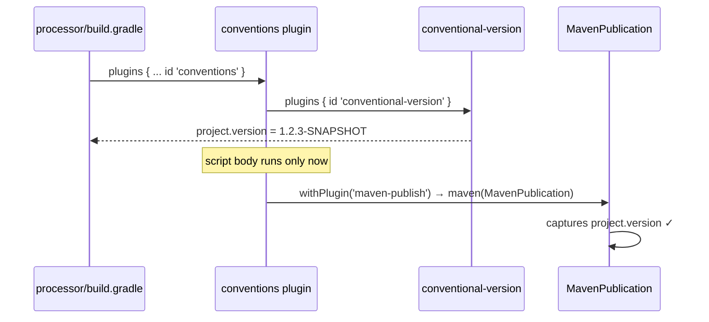

## Context

`buildSrc/build.gradle` states the build's rule: every project plugin version is declared there and
nowhere else, because a version in two places is a version that can disagree with itself — which is
what NullAway did here before the rule existed. Two plugins were carved out as exceptions:
`com.gradleup.nmcp.settings` and `io.github.joke.conventional-version`. Both were exceptions for the
same mechanical reason: a settings plugin can only be applied from `settings.gradle`, and `buildSrc`
is not on the settings classpath, so its version has to travel with it.

`io.github.joke.conventional-version` 2.1.0 removed that constraint. The plugin now dispatches on
what it is applied to; project mode and settings mode compute the same number from the same git read,
and settings mode is described by its own README as "project mode applied to every project". The
exception is no longer forced, so it can be retired. `com.gradleup.nmcp.settings` genuinely cannot
move — it applies nmcp to every project and the aggregation plugin to the root, and reproducing that
from a project convention plugin needs a root `build.gradle` with hand-wired credentials for the same
result.

## Goals / Non-Goals

**Goals:**

- Move `io.github.joke.conventional-version` out of `settings.gradle` and into the `conventions`
  plugin, so its version lands in `buildSrc/build.gradle` with every other project plugin version.
- Narrow the settings-plugin exemption from a list to a single, individually justified entry.
- Preserve the ordering guarantee the current arrangement provides — and record *why* it still holds,
  since the comments that currently defend the settings placement would otherwise read as an argument
  against the change.

**Non-Goals:**

- Moving `com.gradleup.nmcp.settings`. It stays in `settings.gradle` with its version.
- Introducing a root `build.gradle`. The root project stays empty.
- Any change to what is published: coordinates, contents and the release/snapshot split are untouched.
- Upgrading, configuring or otherwise changing the behaviour of the versioning plugin. This is a
  relocation.

## Decisions

### Apply the plugin from the convention plugin's `plugins` block

The alternative is `pluginManager.apply 'io.github.joke.conventional-version'` in the script body,
matching the style used throughout `conventions.gradle` for conditionally applied plugins. Rejected:
those calls are all inside `pluginManager.withPlugin(...)` callbacks, where a `plugins` block cannot
reach. This application is unconditional, and the `plugins` block runs before the script body, which
is exactly the ordering property this change needs.

### The ordering constraint is satisfied structurally, not incidentally

`settings.gradle` currently argues the plugin "has to run before any project is configured, because
maven-publish and nmcp read the version then". The constraint is real: `DefaultMavenPublication`
captures `project.version` when the publication object is created. What changes is how it is met.

The publication is created *by* `conventions.gradle`'s own body. A `plugins` block is evaluated before
that body. So the version cannot be late: the only code that reads it is code that runs after the
code that sets it, in the same file. This is a stronger guarantee than the settings placement gave,
where the ordering held by phase separation across two files.

Alternatives considered: keeping the plugin in `settings.gradle` as well (the README says double
application is harmless — a project already versioned is left alone). Rejected because it reinstates
the two-places-for-one-version problem the move exists to solve.

### Declare the plugin-marker coordinate in `buildSrc/build.gradle`

`implementation 'io.github.joke.conventional-version:io.github.joke.conventional-version.gradle.plugin:2.1.0'`,
not the implementation jar. A precompiled script plugin can only `id`-apply a plugin whose marker
artifact is on the `buildSrc` compile classpath; the marker is what maps id to implementation. This
is a mechanical requirement, not a preference — but it is the first marker coordinate in this file,
so the spec records the form.

### Let the root project stay `unspecified`

Applied at project level, the plugin versions only projects that apply it. Both publishable modules
apply `conventions` (`dependencies/build.gradle`, `processor/build.gradle`); the root project has no
`build.gradle` and so gets nothing. Its version becomes Gradle's default `unspecified`.

Verified inert rather than assumed inert. The root project's only role is hosting nmcp's aggregation
tasks. Reading nmcp 1.6.1's bytecode: nothing in the plugin calls `Project.getVersion()`. The
aggregation `Zip` sets `archiveFileName` explicitly rather than inheriting the
`${baseName}-${version}` default, and the Central deployment name defaults to the *contents* of
`NmcpCheckFilesTask.outputFile` — derived from the coordinates found inside the bundle, which come
from `:processor` and `:dependencies`. There is no path from the root project's version to anything
published or displayed.

Alternative considered: add a root `build.gradle` applying `conventions` purely to version the root.
Rejected — it would reintroduce the root build file that `settings.gradle`'s current comments
explicitly celebrate not having, to fix a value nothing reads.

## Risks / Trade-offs

**A future module that forgets `id 'conventions'` publishes `unspecified` instead of failing** → The
settings plugin covered new modules automatically; project-level application does not. Accepted
rather than mitigated: `conventions` also carries signing, publishing metadata, Spotless and NullAway,
so a module that omits it is visibly broken well before anyone reaches a coordinate. Adding a
verification task to guard a hypothetical third module would cost more than the risk.

**The comments that justify today's arrangement become actively misleading** → Three comment blocks
argue for the settings placement (`settings.gradle` lines 1-15, `buildSrc/build.gradle` lines 10-14,
`conventions.gradle` lines 7-8). Deleting them loses the reasoning; leaving them makes the new code
look like a mistake. Each is rewritten to state the constraint that still holds and how the new
arrangement meets it — the ordering argument above is the replacement for the largest of the three.

**Git is read at project-configuration time rather than settings time** → Both modes read git once
per build and the plugin caches across projects, so this is a shift in *when*, not *how often*.
`build.yml` already requires `fetch-depth: 0` for any job that resolves the version, and that
requirement is unchanged. The configuration-cache scenario in the spec covers the regression risk.
