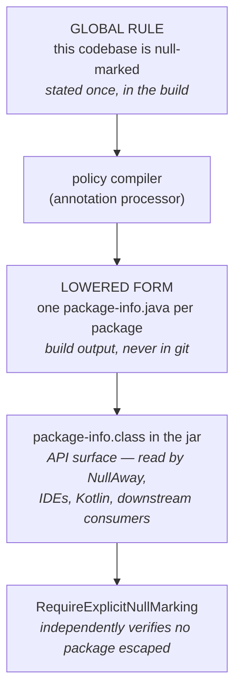
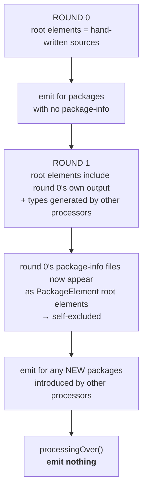

## Framing: a policy compiler

The processor is not "a tool that annotates packages". It is a compiler for a one-line policy that
JSpecify provides no syntax to express:



Two consequences follow from the framing and settle most design questions:

1. **The output is build output.** Committing it would reinstate exactly the boilerplate the
   project exists to remove.
2. **A hand-written `package-info.java` is not a hazard to work around, it is an override.**
   Explicit local declaration beats global default — the same precedence a per-module compiler
   argument has over a project-wide one. This makes the "does it already exist?" check a
   first-class rule rather than a defensive hack.

## Decision: no configuration surface

Rejected: `-Ajspecify.excludePackages=com.foo.legacy,...`.

| | hand-written override | `-A` exclusion list |
| --- | --- | --- |
| lives next to the code it affects | yes | no |
| carries a justification comment | yes | no |
| survives package moves and renames | yes | no — silently stops matching |
| reviewable in the PR that needs it | yes | no |

The one real override in percolate is `docs/mapannotation/package-info.java`, an `@NullUnmarked`
with a three-line comment explaining why that package must resolve `UNKNOWN` rather than
`NON_NULL`. That is what a genuine exception looks like: deliberate, local, explained. An
exclusion list cannot represent it.

Bulk opt-out for a legacy migration is the only scenario the file-based hatch serves badly. It is
deferred until a real migration demands it rather than speculated into v1.

## Decision: eager per-round emission

Emission must not be deferred to `processingOver()`. javac warns *"File for type X created in the
last round will not be subject to annotation processing"*, and the convention plugin compiles with
`-Werror`, so that warning is a build failure.



The round-trip is self-correcting — a generated `package-info.java` becomes a `PackageElement`
root element in the following round and is excluded by the ordinary precedence rule. A
`Set<String>` of already-emitted package names is kept anyway as insurance, and because it is
cheaper than reasoning about javac's round semantics on every future change.

## Decision: three-probe discovery

An existing `package-info` is not always visible the same way. All three probes are needed:

| Probe | Catches |
| --- | --- |
| `PackageElement` present in `roundEnv.getRootElements()` | a `package-info.java` in the current compilation |
| `elements.getPackageElement(pkg)` has annotation mirrors | a `package-info.class` on the classpath |
| `FilerException` from `createSourceFile` | re-creation within the same run |

The classpath probe was originally specified as `getTypeElement(pkg + ".package-info")`.
**That does not work**, and implementation caught it: `package-info` is not a valid Java identifier,
so the lookup never resolves and the probe silently returned "not covered" for every package. The
working probe reads the *effect* instead of the file: javac only emits a `package-info.class` when
the package declaration carries annotations, so a package that arrives already carrying annotation
mirrors is one with a `package-info` behind it.

One consequence is worth stating plainly: a classpath `package-info` with javadoc but no
annotations produces no class file at all, so it is invisible here and the package would be
generated. That case cannot be detected from the classpath by any means, and it is harmless — a
package-info with no annotations contributes no nullness information to lose.

The classpath probe is what stops a test compilation from generating a second `package-info` for a
package that `src/main/java` already covers. It is not merely deduplication: a `package-info.class`
loaded from the classpath genuinely supplies `@NullMarked` to the test compilation's package
symbol, so skipping is the correct behaviour, not a compromise.

Note that split-package duplicates already exist in percolate and are tolerated —
`io.github.joke.percolate` has a hand-written `package-info.java` in both `annotations/` and
`processor/`, as does `io.github.joke.percolate.docs.extending` across two test source sets. The
processor reproducing that pattern is no worse than the status quo.

## Decision: AGGREGATING incremental annotation processing

A processor that ships no `META-INF/gradle/incremental.annotation.processors` entry causes Gradle
to disable incremental compilation **for every module the processor is applied to**. Since the
value proposition is applying this to every module of every build, that penalty would be paid
everywhere, and the tool would rightly be removed.

`ISOLATING` does not apply: an isolating processor's output must derive from exactly one
originating element, whereas a `package-info` derives from every type in its package. The
processor is declared `AGGREGATING` and passes the package's `TypeElement`s as originating
elements to `Filer.createSourceFile`.

## Decision: no `@Generated` on the output

The convention plugin sets `treatGeneratedAsUnannotated = true`. That setting suppresses analysis
*of* generated code, and a `package-info.java` contains no code to analyse — so `@Generated` is
very probably harmless. It is still omitted, because this is the single file in the build whose
purpose is to switch null-checking *on*, and there is no benefit to weigh against even a small
chance of switching it off. Provenance goes in a comment.

## Decision: `process()` returns `false`

The processor claims `"*"`. Returning `true` would consume every annotation in the compilation and
silently break every other processor in the build. One boolean, catastrophic if wrong, so it gets
its own test.

## Generated content

```java
// Generated by io.github.joke.jspecify — do not edit. See <project url>.
@org.jspecify.annotations.NullMarked
package com.example.foo;
```

Fully-qualified annotation reference, no import, no `@Generated`. Two meaningful lines, hand-built
with string concatenation — a code generator for this would be ceremony without benefit. This
matches the dominant form already used in percolate (42 of 46 files).

## Decision: the consuming project supplies JSpecify

The generated file does not compile unless `org.jspecify:jspecify` is on the **consumer's compile
classpath**, and an `annotationProcessor` dependency does not put it there — Gradle resolves that
configuration onto the processor path only.

This project does not supply it. JSpecify stays `compileOnly` here, the published POM carries no
dependencies at all, and the consuming project declares `org.jspecify:jspecify` itself at a version
it chooses:

```groovy
dependencies {
    annotationProcessor 'io.github.joke.jspecify:processor'
    compileOnly         'org.jspecify:jspecify'    // the consumer's own choice of version
}
```

Anyone adopting this tool is already annotating with JSpecify and already has a version opinion —
very likely a pinned one, possibly through a platform. Pushing ours in transitively would put this
project in the business of arbitrating that version and risk conflicting with a pin the consumer
set deliberately. A zero-dependency processor artifact cannot cause that argument.

The cost is that a consumer can forget the second line, so the availability probe carries real
weight: the processor resolves `elements.getTypeElement("org.jspecify.annotations.NullMarked")`
and, if absent, emits one clear `ERROR` naming the missing dependency and generates nothing —
instead of emitting a file that fails with `cannot find symbol` in a location the consumer did not
write and cannot find.

## Dogfood finding: opting a module out is a build-wiring decision

Running the processor against a scratch copy of percolate with its 45 boilerplate
`package-info.java` files deleted regenerated all of them, compiled green under NullAway with
`RequireExplicitNullMarking` as an error, and left the one deliberate `@NullUnmarked` override
untouched.

It also surfaced a consequence worth stating. Because the missing-JSpecify diagnostic is an
`ERROR`, wiring the processor into a *shared* convention plugin makes it effectively mandatory for
every module in the build: a module without JSpecify no longer compiles. percolate's
`lib:javapoet` — a vendored copy of Palantir JavaPoet, deliberately unannotated, with zero
`package-info.java` files — is exactly that case. Adding JSpecify to it so the processor could run
null-marked third-party code, which changed `CodeBlock.Builder.addStatement(String, Object...)`
parameters to `@NonNull` and broke a caller that legitimately passed a `@Nullable` map lookup.

The right answer is not to soften the diagnostic. It is that **opting a module out means not
applying the processor to that module**, exactly as with any other annotation processor. The
per-package hand-written override is for exceptions within a module that has opted in; whole
modules opt out at the build-wiring level. The `ERROR` stays, because a processor that silently did
nothing when JSpecify was absent would reintroduce precisely the silent hole this project exists to
close.

## Decision: Spock, despite the size

The production code is on the order of one class. Spock 2.4 on Groovy 5, with CodeNarc behind it,
is heavy machinery for that — but it is the house stack, and the alternative buys a smaller build
file at the cost of every test in this repository reading differently from every test in the
neighbouring one. `compile-testing` remains the harness underneath; Spock only wraps it.

## Spike results (2026-07-31)

Both gating questions were answered with a throwaway three-module Gradle harness against the exact
versions this project pins: Error Prone 2.49.0, NullAway 0.13.4, JSpecify 1.0.0, JDK 25,
`options.release = 11`, `-Werror`, and the full percolate NullAway configuration
(`jspecifyMode`, `onlyNullMarked`, `treatGeneratedAsUnannotated`, `RequireExplicitNullMarking`
as error).

**The premise holds.** A `package-info.java` generated in round 0 is fully honoured during flow
analysis of sources parsed in the same round:

| Arm | Result |
| --- | --- |
| Control: processor disabled, package unmarked | `RequireExplicitNullMarking` errors on the class; NullAway silent about the null return |
| Main: processor enabled, `package-info` generated | NullAway reports *"returning @Nullable expression from method with @NonNull return type"*; `RequireExplicitNullMarking` silent |
| Main, violation removed | `BUILD SUCCESSFUL` under `-Werror` — no last-round warning |

The control arm matters: it proves the finding in the main arm came from the generated file rather
than from some other default. The emitted `package-info.class` was confirmed to carry
`RuntimeVisibleAnnotations: org.jspecify.annotations.NullMarked`, so the marking does reach the
class file and therefore the jar.

## Decision: skip modules that are already null-marked

`@NullMarked` targets `MODULE`, so a JPMS project can state the rule once in `module-info.java` —
the exact altitude this project exists to supply for everyone else.

The spike confirms NullAway honours it: a module whose `module-info.java` carries `@NullMarked`,
containing a package with **no** `package-info.java` and a definite violation, had that violation
reported. `RequireExplicitNullMarking`'s own diagnostic text says the same
("...or be in a module that is explicitly `@NullMarked`").

Generating per-package files for such a compilation would therefore be pure noise. When the
enclosing module is already null-marked the processor generates nothing.

Detection reads annotation *mirrors* by qualified name rather than
`getAnnotation(NullMarked.class)`, since JSpecify is `compileOnly` here and must not be required on
the processor's own runtime classpath.

## Non-goals

- Bulk exclusion by package prefix.
- Emitting `@NullUnmarked`, or any annotation other than `@NullMarked`.
- Rewriting or amending an existing `package-info.java`.
- Diagnosing a hand-written `package-info.java` that lacks null marking. Error Prone's
  `RequireExplicitNullMarking` already reports exactly that, with a diagnostic pointing at the
  real file. The division of labour is: this processor fills the gaps, that check proves none
  remain. Consumers who do not enable it keep the silent-hole failure mode; that is documented,
  not solved here.
- Any support for build tools other than plain javac. The processor is build-tool agnostic by
  construction; only the Gradle incremental declaration is tool-specific.
